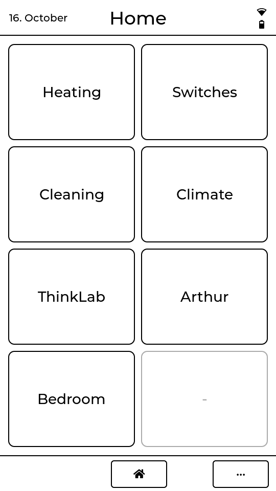
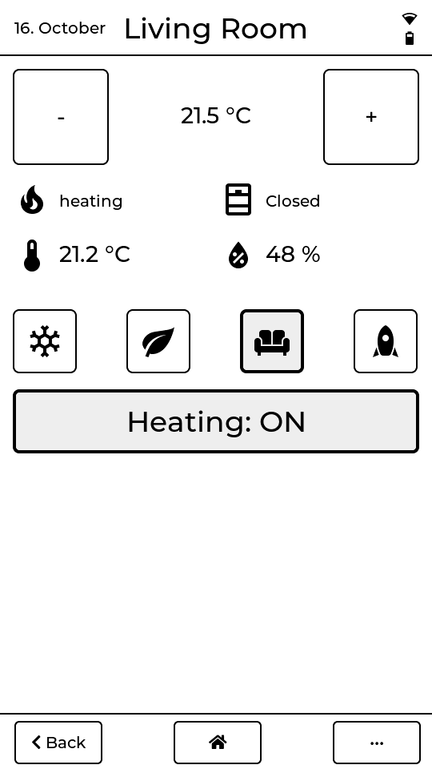
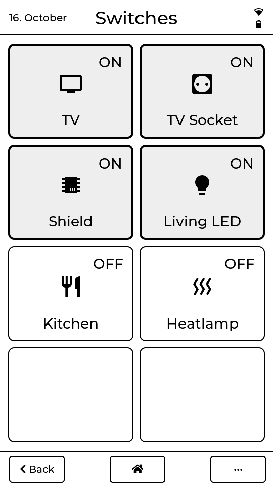
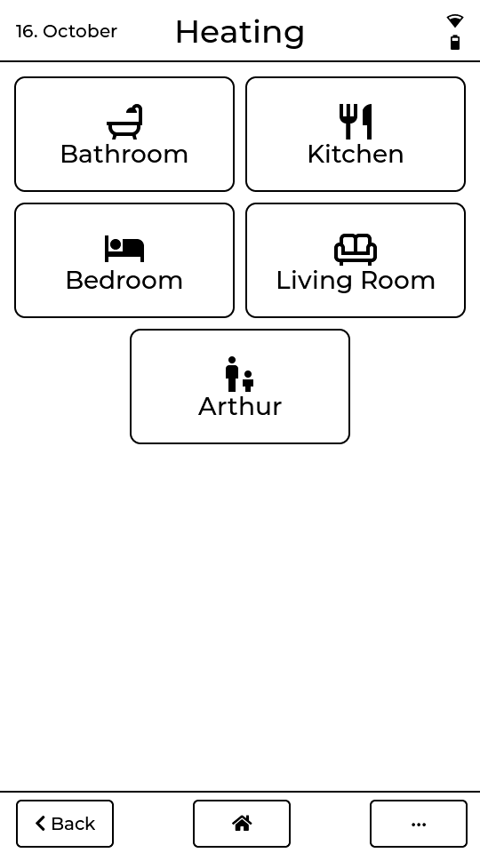
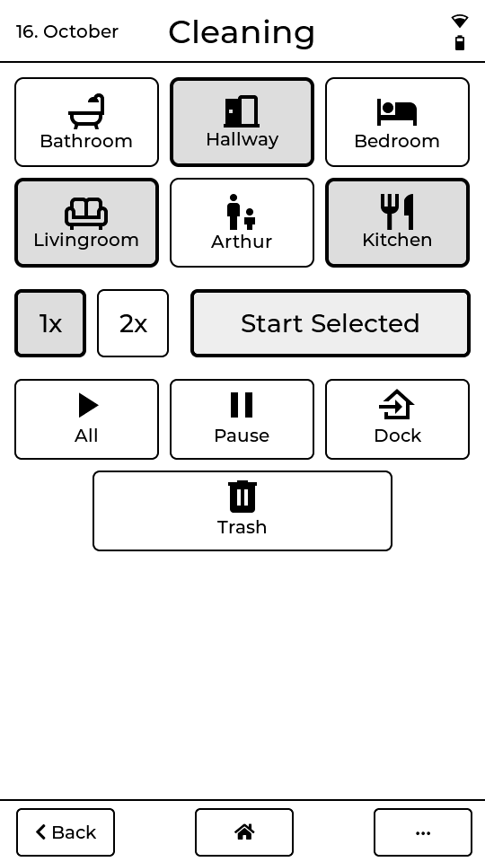
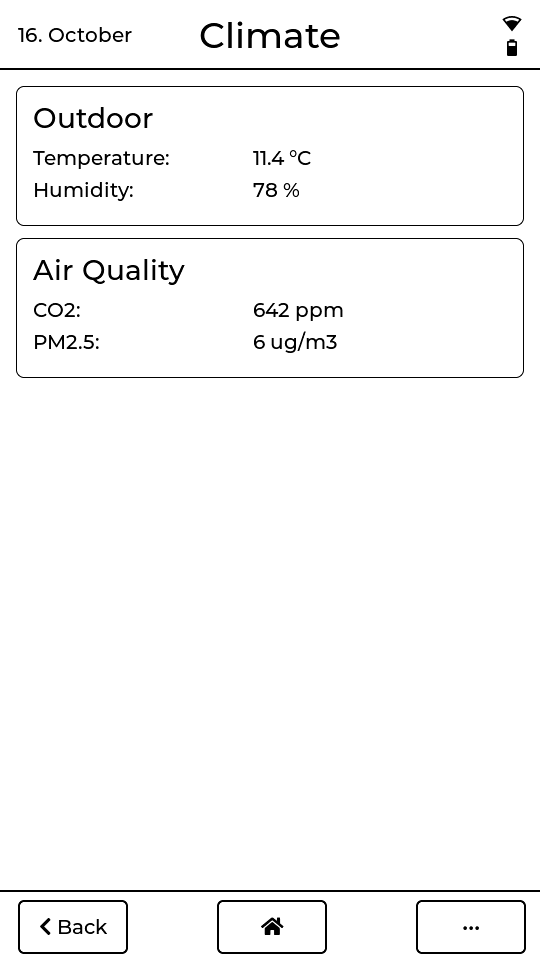
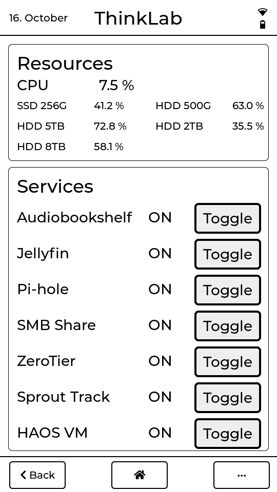
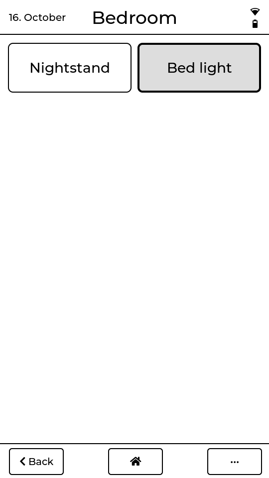
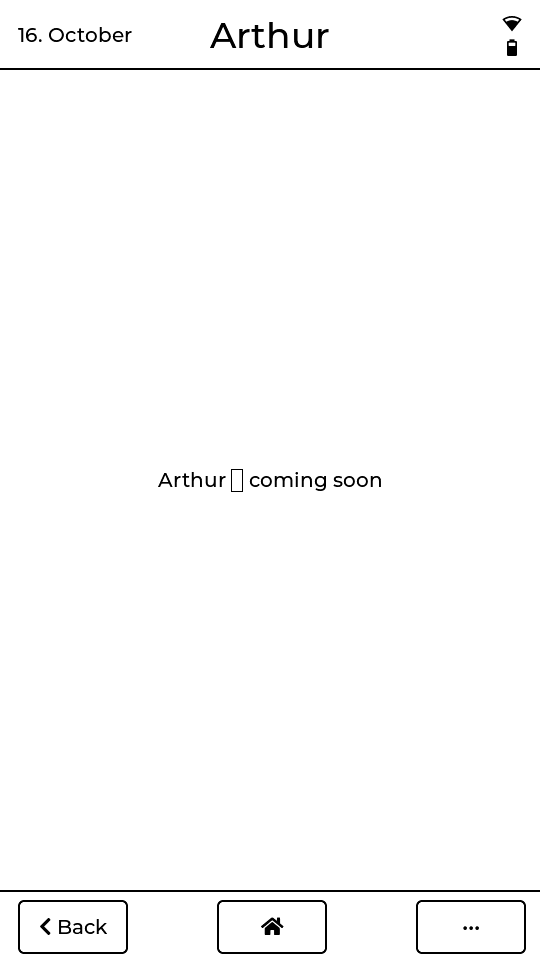
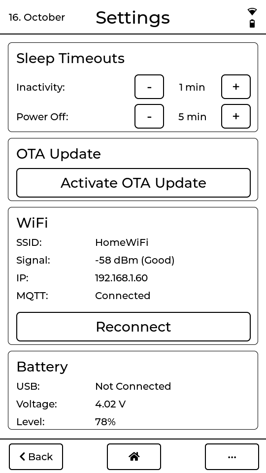

# PaperS3 Dashboard

[](https://github.com/Boisti13/papers3-dashboard/tags)
[](platformio.ini)
[](https://lvgl.io/)
[](ha/papers3dash.yaml)
[](LICENSE)

Turn the **M5Stack PaperS3** (SKU C139, ESP32-S3, 4.7" 540×960 e-paper with
touch) into a wall or table remote for [Home Assistant](https://www.home-assistant.io/).
Tap through eight pages: set the radiators, switch the TV and lights, send the
robot vacuum to chosen rooms, look at the air quality, start and stop the
home server's containers. The firmware is plain Arduino/C++ with an
[LVGL](https://lvgl.io/) interface, talks to Home Assistant over MQTT, and
goes to sleep when nobody touches it — the e-paper keeps the last page.

<p align="center">&nbsp;&nbsp;&nbsp;&nbsp;</p>

<p align="center"><sub>Rendered from the firmware's own UI code with sample values, in the panel's 16 grey levels (see <a href="#screenshots">Screenshots</a>).</sub></p>

## Highlights

- **Eight touch pages** — Heating, Switches, Cleaning, Climate, ThinkLab, Arthur (a placeholder for now), Bedroom and Settings — from a grid launcher on the home page
- **Two-way with Home Assistant over MQTT**: values come in through `mqtt_statestream`, taps go out as MQTT commands that a [Home Assistant package](ha/papers3dash.yaml) turns into actions
- **Instant start**: the home page appears at once, Wi-Fi connects in the background and reconnects on its own (forced retry after 30 s)
- **Header at a glance**: date, 4-bar Wi-Fi signal and an MDI battery icon (level, charging, USB full)
- **E-paper refresh tuned for touch**: a tap redraws at once, page changes use the fast mode, every fifth refresh is a full-quality pass that clears ghosting
- **Two-stage sleep**: light sleep after a minute without touch (a tap wakes it and still counts as a tap), then power-off with a standby screen after 5 minutes; both times adjustable on the Settings page and kept across restarts
- **Keeps the time without Wi-Fi**: the hardware RTC holds date and time through power-off; NTP sets it again on every connect
- **Settings page**: Wi-Fi (SSID, signal in dBm with a quality label, IP) and MQTT status, battery voltage and USB state, sleep times, OTA
- **Over-the-air updates from the browser**: start OTA on the Settings page, open the device's address, upload the `.bin`
- **Shows up in Home Assistant** by MQTT discovery as *PaperS3 Dashboard* with battery and Wi-Fi signal

## Pages

| Page | What it shows and does |
|---|---|
| **Home** | grid launcher for all other pages |
| **Heating** | a tile per room (bathroom, kitchen, bedroom, living room, Arthur); each opens the room's page: target temperature with − / +, heating or idle, window open or closed, room temperature and humidity, preset (frost, eco, comfort, boost) and heating on/off |
| **Switches** | 2×4 grid: TV, TV socket, Shield, living room and kitchen lights, Arthur's socket (two tiles free) |
| **Cleaning** | Roborock S6 MaxV: pick rooms, repeat count, clean selected rooms or everything, pause, dock, go to the trash can |
| **Climate** | outdoor temperature and humidity, CO₂, PM2.5 |
| **ThinkLab** | Proxmox server: CPU, five disks' usage, start/stop for its LXCs and the Home Assistant VM |
| **Arthur** | placeholder (*coming soon*) |
| **Bedroom** | RGB strip and RGB bulb on/off |
| **Settings** | sleep times, OTA, Wi-Fi/MQTT with a *Reconnect* button, battery |

<table>
<tr>
<td align="center"><br><sub>Home</sub></td>
<td align="center"><br><sub>Heating</sub></td>
<td align="center"><br><sub>Heating → Living Room</sub></td>
<td align="center"><br><sub>Switches</sub></td>
<td align="center"><br><sub>Cleaning</sub></td>
</tr>
<tr>
<td align="center"><br><sub>Climate</sub></td>
<td align="center"><br><sub>ThinkLab</sub></td>
<td align="center"><br><sub>Bedroom</sub></td>
<td align="center"><br><sub>Arthur</sub></td>
<td align="center"><br><sub>Settings</sub></td>
</tr>
</table>

## How it works

```
Home Assistant                                       PaperS3 (this firmware)
mqtt_statestream ── homeassistant/<domain>/<id>/… ─▶  updates the page values
                                                      (subscribed to every topic in config.h)

packages/papers3dash.yaml ◀── homeassistant/<domain>/<id>/set ──  a tap on a tile / button
  automations: call the service                       (climate, switch, light, remote, vacuum …)

  "push on connect"       ◀── papers3dash/availability = online ─  device (re)connects
  republishes slow values ─▶ (disk usage, bedroom lights)
```

`mqtt_statestream` only publishes when a state changes, so values that rarely
change (disk usage, the bedroom lights) are pushed again by the package each
time the PaperS3 comes online.

## Install

You need Home Assistant with an MQTT broker (e.g. the Mosquitto add-on),
[PlatformIO](https://platformio.org/) (VS Code extension or CLI), a PaperS3
and a USB-C cable.

**1. Credentials.** Copy the template and fill in Wi-Fi and the MQTT broker:

```bash
git clone https://github.com/Boisti13/papers3-dashboard.git
cd papers3-dashboard
cp src/secrets.h.template src/secrets.h
```

```cpp
#define SECRET_WIFI_SSID     "your-ssid"
#define SECRET_WIFI_PASSWORD "your-password"
#define SECRET_MQTT_HOST     "192.168.x.x"
#define SECRET_MQTT_USER     "mqtt-user"
#define SECRET_MQTT_PASS     "mqtt-password"
```

`src/secrets.h` is gitignored.

**2. Your entities.** Every MQTT topic is in [`src/config.h`](src/config.h),
named after Home Assistant entity IDs (`homeassistant/<domain>/<entity_id>/…`).
Change them to your own entities. The time zone (`TIMEZONE`, POSIX format)
is there too.

**3. Home Assistant.** Turn on packages once in `configuration.yaml`, if you
haven't already:

```yaml
homeassistant:
  packages: !include_dir_named packages
```

Then add two files to `/config/packages/`:

| File | What it is |
|---|---|
| `papers3dash.yaml` | copy of [`ha/papers3dash.yaml`](ha/papers3dash.yaml): the automations that act on the PaperS3's commands, and the push-on-connect |
| `mqtt_statestream.yaml` | your own file with `mqtt_statestream:` (`base_topic: homeassistant`, `publish_attributes: true`) and every entity used in `config.h` under `include: entities:` — the list is in the comment at the top of `ha/papers3dash.yaml` |

Check the configuration and **restart** Home Assistant — `mqtt_statestream`
is only read at start; the automations alone would reload with *All YAML
configuration*.

**4. Build and flash** over USB:

```bash
pio run --target upload
```

The PaperS3 appears in Home Assistant under *Settings → Devices & services →
MQTT* as **PaperS3 Dashboard**.

## Updates over Wi-Fi

On the Settings page, tap **OTA**: the device stays awake and shows its
address. Open that address in a browser, choose `.pio/build/PaperS3/firmware.bin`
and upload — it reboots into the new firmware. Or build and upload in one go:

```bash
./ota_upload.sh <device-ip>
```

## Home Assistant entities

**From the device** (MQTT discovery):

| Entity | State | MQTT topic |
|---|---|---|
| *PaperS3 Dashboard Battery* | battery, % | `papers3dash/sensor/battery/state` |
| *PaperS3 Dashboard WiFi RSSI* | Wi-Fi signal, dBm (diagnostic) | `papers3dash/sensor/wifi_rssi/state` |
| availability | `online` / `offline` (retained, last will) | `papers3dash/availability` |

The device also sends `online` (not retained) to `paperdash/status` on every
connect, for older versions of the package.

**From the package** — automations only, no entities of their own:

| Automation | Listens on | Does |
|---|---|---|
| *PaperS3 – Push disk sensors on connect* | `papers3dash/availability` = `online` | republishes the ThinkLab disk sensors |
| *PaperS3 – Push bedroom lights on connect* | same | republishes the two bedroom lights |
| *PaperS3 – Heating page sets HVAC mode / preset / temperature* | `paperdash/climate/<id>/…` | `climate.set_*` (what the heating page sends) |
| *PaperS3 – Set radiator temperature / preset* | `homeassistant/climate/<id>/…` | `climate.set_*` (older topics) |
| *PaperS3 – Switch a switch / light / remote*, *Select vacuum room* | `homeassistant/<domain>/<id>/set` | `turn_on` / `turn_off` |
| *PaperS3 – Start vacuum, Pause vacuum, Send vacuum to dock / trashcan, Set vacuum repeat* | `homeassistant/vacuum/roborock_s6_maxv/…`, `…/script/…/set`, `…/input_select/vacuum_repeat/set` | start, pause, dock, repeat, clean selected rooms, go to trash can |

Each automation has an `id` (`papers3_…`), so it can be edited and traced in
Home Assistant.

## Hardware

| | |
|---|---|
| Board | M5Stack PaperS3 (SKU C139) |
| SoC | ESP32-S3, 16 MB flash, 8 MB octal PSRAM (LVGL's memory and a full-screen draw buffer live there) |
| Display | 4.7" 540×960 e-paper, 16 grey levels, driven through M5Unified/M5GFX (epdiy) |
| Touch | GT911 capacitive, I²C |
| RTC | on board, keeps time through power-off |
| Power | internal LiPo or USB-C; GPIO44 is the power hold, set first at boot |

## Software

| Component | Version |
|---|---|
| PlatformIO platform | `espressif32`, Arduino framework, board `esp32-s3-devkitm-1` |
| [M5Unified](https://github.com/m5stack/M5Unified) | ^0.2.5 |
| [LVGL](https://lvgl.io/) | ^8.3.0 |
| [PubSubClient](https://github.com/knolleary/pubsubclient) | ^2.8.0 |
| [ArduinoJson](https://arduinojson.org/) | ^7.0.0 |

## Repository layout

```
src/
  main.cpp                 # boot, main loop, Wi-Fi reconnect, status updates
  config.h                 # all MQTT topics, time zone, pins
  secrets.h.template       # copy to secrets.h (gitignored)
  lv_conf.h                # LVGL config (PSRAM allocator)
  display/
    epd_driver.*           # LVGL → e-paper flush, fast/quality refresh
    nav.*  styles.*  ui.*  # page switching, styles, header
    pages/<page>/          # one folder per page
  fonts/                   # MDI icon fonts (20, 48 px, battery)
  mqtt/ha_mqtt.*           # PubSubClient, topic dispatch, discovery
  ota/ota.*                # browser OTA server
  power/battery.* sleep.*  # battery via M5.Power, light sleep / power-off
  time/rtc_sync.*          # RTC restore, NTP sync
  touch/gt911.*            # touch → LVGL input
ha/
  papers3dash.yaml         # Home Assistant package
ota_upload.sh              # build and upload over Wi-Fi
docs/screenshots/          # rendered pages for this README
tools/render/              # renders them on a Linux PC (no device needed)
```

## Development

`main` holds released versions, `dev` is where work happens. Changes go to
`dev`, get tested on a real PaperS3, and are merged to `main` with a release
(`vX.Y.Z` tag, notes from [CHANGELOG.md](CHANGELOG.md)). Build without
flashing:

```bash
pio run
```

### Screenshots

The pictures in this README are not photos: [`tools/render/`](tools/render)
builds the real page code (`src/display/`) on a Linux PC against small stubs
for Wi-Fi, MQTT, OTA and sleep, fills in sample values, and writes every page
as a 540×960 PNG in the panel's 16 grey levels. After a UI change, render
them again (needs gcc, g++ and zlib; LVGL 8.3 as PlatformIO uses it):

```bash
git clone --depth 1 -b v8.3.11 https://github.com/lvgl/lvgl /tmp/lvgl
bash tools/render/build.sh "$PWD" /tmp/lvgl docs/screenshots
```

The sample values are in `sample_values()` in `tools/render/render.cpp`.

## License

[MIT](LICENSE).
